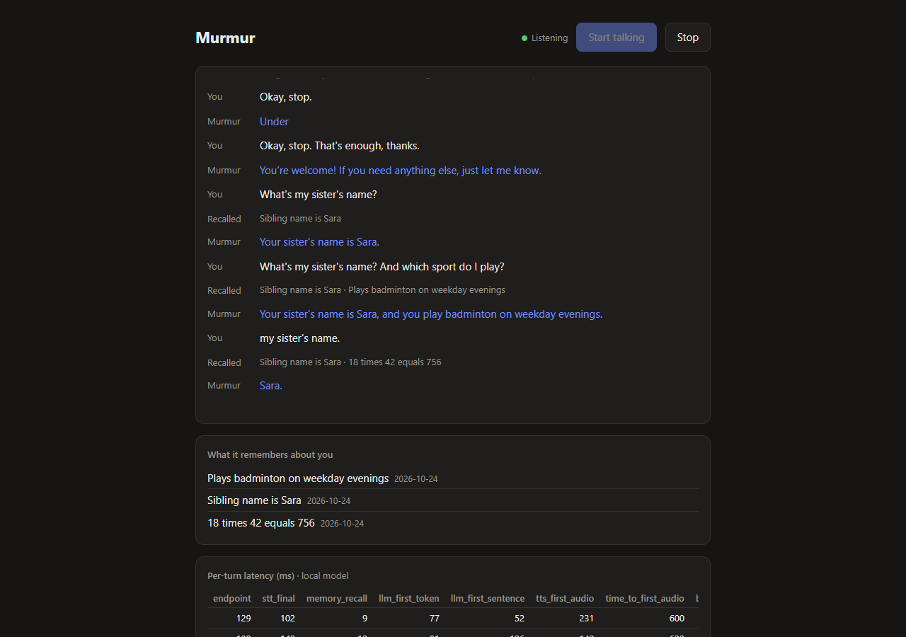

# Murmur

**A voice agent that runs on a laptop GPU, answers in under a second, and remembers you.**

You talk; it answers out loud fast enough to feel like a conversation. You can cut it off
mid-sentence and it stops. It uses tools mid-turn. Tell it something about yourself today
and it still knows next week, and it forgets on request.

Everything below is measured. Numbers in the tables are generated from results files by
`scripts/readme_numbers.py`; anything not yet measured says `TBD`.

## Demo

[](docs/media/demo.mp4)

**[▶ Watch the 53-second demo (with sound)](docs/media/demo.mp4)**: the real app in Chrome. The
"user" is a scripted synthetic voice fed in as the microphone; everything else is live on an
RTX 4060 Laptop GPU:

1. *"I play badminton on weekday evenings, and my sister is called Sara."* Two facts written
   to long-term memory in the background, never on the turn path.
2. *"What is eighteen times forty two?"* The model calls the `calculate` tool over MCP → 756.
3. *"Tell me a story about a dragon…"* then, mid-story, *"Okay, stop."* Playback stops within
   ~66 ms of the interruption, and only the words actually heard go into history.
4. *"What's my sister's name, and which sport do I play?"* Recalled from long-term memory.

**Live link:** TBD (deploying to Google Cloud Run, see [`docs/deploy.md`](docs/deploy.md)).

## What's hard about this

**Latency.** A conversation breaks down past roughly 800 ms from when you stop talking to
when you hear a reply. That budget covers deciding you have finished, transcription,
generation and speech synthesis, with three models sharing 8 GB of VRAM.

**Memory.** Not a transcript stuffed into the context window: a layer that decides what is
worth keeping, merges duplicates, notices when something you said last week is no longer
true, retrieves what matters inside a 40 ms budget, and never writes on the turn path.

**Turn-taking.** Telling a pause from the end of a thought, stopping cleanly when
interrupted, and recording what the user actually *heard*, not what was generated.

## Results

| Gate | Result | Report |
| --- | --- | --- |
| 1. It talks | Spoken conversation end to end; baseline 2382 ms to first audio | [R1](reports/R1-pipeline.md) |
| 2. It remembers | Fact recalled across a process restart; recall 8–10 ms live (40 ms budget); forget is a hard delete | [R2](reports/R2-memory.md) |
| 3. It feels real | **756 ms** p50 to first audio; barge-in stops playback in **66 ms**; interrupted replies recorded as heard | [R3](reports/R3-latency.md) |
| 4. It ships | Local vs hosted measured; README numbers by script; public link TBD | [R4](reports/R4-final.md) |

### Latency

Generated by `scripts/readme_numbers.py`; edits by hand are overwritten.

<!-- latency:start -->
| Stage | Local (RTX 4060 Laptop) | Hosted | Budget |
| --- | --- | --- | --- |
| Endpointing | 130 / 131 ms | 130 / 131 ms | 200 ms |
| Transcription (final) | 128 / 147 ms | 135 / 164 ms | 100 ms |
| Memory recall | 10 / 12 ms | 9 / 12 ms | 40 ms |
| Model, first token | 118 / 160 ms | 989 / 1342 ms | 250 ms |
| Model, first chunk | 170 / 338 ms | 112 / 455 ms | — |
| Speech, first audio | 204 / 352 ms | 175 / 250 ms | 200 ms |
| **Time to first audio** | **756 / 1110 ms** | **1652 / 2099 ms** | **800 ms** |

p50 / p90, from `results/r3/tuned/latency.json` + `results/r3/hosted/latency.json` (2026-10-14T17:57:20+00:00); answered turns per backend: local 20, hosted 20. Local: Qwen/Qwen2.5-1.5B-Instruct on vLLM, NVIDIA GeForce RTX 4060 Laptop GPU. Hosted: anthropic/claude-haiku-5.5. Interrupting it stops audible playback in 66 / 66 ms (first speech frame to stop command; `reports/R3-latency.md`).
<!-- latency:end -->

The local GPU is **faster than the hosted API**. Claude Haiku via OpenRouter is the smarter
model, but the network round trip puts its first token at ~1 s, against 118 ms for a 1.5B
model on the same machine as the microphone.

How it got from 2382 ms to 756 ms, one change at a time ([R3](reports/R3-latency.md)):

| Change | Time to first audio, p50 |
| --- | --- |
| Baseline: TTS on CPU, whole first sentence | 2382 ms |
| First TTS chunk may end at a comma | 1683 ms |
| Kokoro TTS on the GPU | 789 ms |
| Speculative endpointing from 128 ms | **756 ms** |

### Memory

<!-- memory:start -->
| Check | Development set | Held-out set |
| --- | --- | --- |
| Recall precision (fact in top 4) | 24/28 | 4/8 |
| Spoken answer uses the fact | 22/28 | 5/8 |
| Contradiction: old fact superseded | 4/5 | 2/2 |

Store growth: 50 records per 100 turns before consolidation, 35.5 after. Recall 17 ms p50 against a 40 ms budget. From `results/memory_eval/report.json`; scripted facts, not a benchmark — `reports/R2-memory.md` has what was tuned and what the held-out set shows.
<!-- memory:end -->

## How it works

```
 mic (browser AudioWorklet, 16 kHz PCM over WebSocket)
  │
  ▼
 Silero VAD ── onset (96 ms) ──► pause playback ── confirmed (250 ms) ──► cancel turn + clear
  │
  ▼ speech                                         ┌──────────────────────────────┐
 faster-whisper (GPU) ── endpoint (128 ms) ──►     │ recall: embed + score, 40 ms │
                                                   └──────────────┬───────────────┘
                                                                  ▼
                    agent loop: Qwen2.5-1.5B on vLLM (or Claude via OpenRouter)
                         │ tokens                │ tool calls (MCP)
                         ▼                       ▼
            sentence/clause chunker        memory server: forget
                         │                 tools server: calculate, current_time
                         ▼
            Kokoro TTS (GPU) ── held until 600 ms of silence ──► browser playback
                                                                       │
          after the turn, off the critical path:                        ▼
          extract facts → ground → write → consolidate        playback report on cut:
                                                              "which words were heard"
```

### Decisions worth reading

- **Speculative endpointing.** 200 ms of silence cut 7 of 16 real utterances mid-sentence;
  600 ms cut none but adds 600 ms to every turn. So a turn *starts* at 128 ms and *speaks*
  no earlier than 600 ms. If the user carries on, the turn is cancelled unheard and their
  words merge into the next one. In 62 measured turns no reply was ever heard over a pause.
- **Two-stage barge-in.** Waiting for 250 ms of confirmed speech can never meet a 200 ms cut,
  so 96 ms of speech *pauses* playback, confirmation *clears* it, and a cough *resumes* it.
- **Recording what was heard.** The browser reports how many samples it dropped on a cut;
  a per-sentence ledger maps that back to words, so history holds "Once upon a time, there"
  rather than the paragraph that was generated.
- **Memory never blocks a turn.** Recall reads an immutable in-memory snapshot (no database,
  no lock); writes and consolidation run in a background worker that waits for silence.
- **Guards around a 1.5B model.** It invented facts, judged contradictions too eagerly and
  called tools it wasn't asked to. Each failure got a deterministic guard (a grounding check,
  a similarity gate before the contradiction judge, intent-gated tools), measured in R2.
- **One protocol, two backends.** vLLM and OpenRouter both speak OpenAI's chat API; the only
  difference is that Claude 5.x rejects sampling parameters, so the hosted backend sends a
  reasoning effort instead.
- **Private demo memory.** In the public demo each browser gets its own store, so one
  visitor never hears another's facts.

More in [`docs/01-architecture.md`](docs/01-architecture.md),
[`docs/02-memory.md`](docs/02-memory.md) and the decisions log in
[`docs/03-tech-stack.md`](docs/03-tech-stack.md).

## Running it

Linux, or WSL2 on Windows (vLLM does not run natively on Windows). Needs
[uv](https://docs.astral.sh/uv/) and an NVIDIA GPU (developed on an RTX 4060 Laptop, 8 GB).

```bash
make setup           # app venv (incl. onnxruntime-gpu) + pre-commit hooks
make setup-vllm      # vLLM in its own venv (it pins its own torch)
make models          # VAD, STT, TTS, embedding and LLM weights
make serve           # terminal 1: vLLM on :8000
make run             # terminal 2: the agent on http://localhost:8080
make check           # lint, strict type check, 60 tests
```

Open the page in Chrome or Edge and press **Start talking**. Use headphones, or set
`MURMUR_BARGE_IN=false`, so it doesn't hear itself.

Backends:

```bash
MURMUR_BACKEND=local                                        # default: Qwen2.5-1.5B on vLLM
MURMUR_BACKEND=hosted MURMUR_OPENROUTER_API_KEY=sk-or-...    # Claude Haiku 5.5 via OpenRouter
```

Whisper and Kokoro run locally either way; only the language model moves.
`MURMUR_TTS_DEVICE=cpu` runs speech synthesis on the CPU.

Measuring and testing:

```bash
uv run python scripts/replay.py clips/*.wav            # talk to it with recorded clips
uv run python scripts/replay.py --interrupt-after 1.5 ask.wav cut.wav   # scripted barge-in
uv run python scripts/memory_eval.py [--final]         # the scripted memory check
bash scripts/gate3.sh                                  # every latency configuration
uv run python scripts/readme_numbers.py --latency ...  # regenerate the tables above
```

Deploying the public demo (Cloud Run, CPU or one L4 GPU, scales to zero):
[`docs/deploy.md`](docs/deploy.md).

## Project layout

```
src/murmur/
├── audio/        frames, Silero VAD, onset/endpoint detection
├── stt/ tts/     one interface each; faster-whisper, Kokoro (ONNX, CPU or GPU)
├── llm/          one interface; vLLM (local) and OpenRouter (hosted) over one client
├── agent/        agent loop, prompts, memory jobs (extraction, consolidation), MCP tools
├── memory/       SQLite store, embeddings, recall/supersede/decay/forget
├── mcp_servers/  memory (forget, recall, remember, history) and tools (calculate, time)
├── pipeline/     orchestrator (turns, cancellation, settle), playback ledger, metrics
└── web/          FastAPI app, WebSocket, AudioWorklets, demo page
scripts/          replay, evals, latency runs, demo recording, deploy
reports/          R1–R4: what was measured, what broke, what changed
```

## Known issues

- **p50 is inside the 800 ms budget; p90 is not** (1110 ms). The tail is a long opening clause.
- The 1.5B local model is weak at tool calls (1 of 3 in R3) and ignores length instructions.
- Memory extraction misses some facts (held-out recall 4/8 in R2) and can supersede the wrong
  one; "please forget X" can lose its first words when endpointing splits the sentence.
- Proper nouns: Whisper heard "Afifa" as "a Phiffa".
- Latency figures are from one machine. Yours will differ.

## Built with

faster-whisper · Silero VAD · Kokoro (ONNX Runtime) · vLLM · Qwen2.5-1.5B-Instruct ·
Claude Haiku 5.5 via OpenRouter · fastembed (bge-small) · SQLite · MCP Python SDK · FastAPI ·
Web Audio AudioWorklets · Google Cloud Run

## Licence

MIT.
